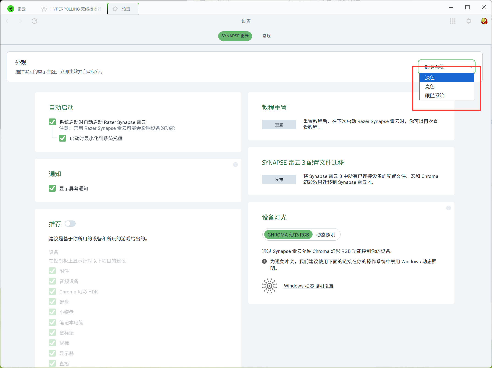
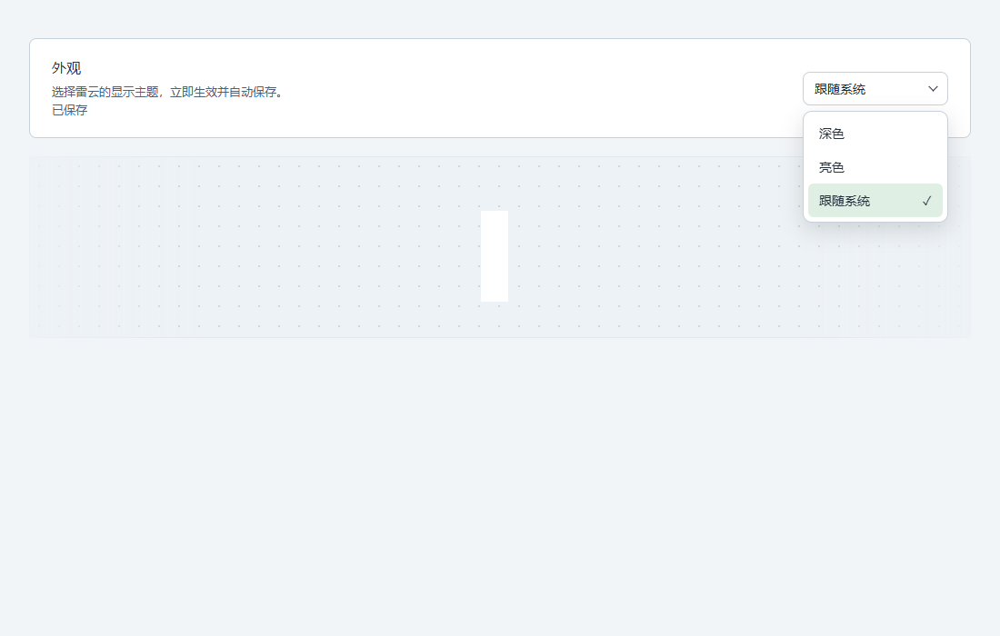

# Razer Synapse Personal Patches

按个人审美修改的雷云 4 界面补丁，另附本机排查过程中使用的运行时修复工具。

**这只是我自己用的外观修改，没有做很多稳定性测试。建议优先使用雷蛇官方原版。**

不是官方项目，也不保证适用于所有设备、页面或后续版本。如果出现启动失败、显示异常等问题，请还原。

## 改了什么

- 深色、亮色、跟随系统，可在设置页的「外观」中选择，自动保存。
- 浅色背景、卡片、文字、设备展示区域和标签页关闭按钮的配色。
- 主题选择菜单的圆角和选中状态。
- 左键托盘弹出窗口使用 12px 原生窗口区域圆角，随窗口尺寸变化更新，亮色和深色共用。
- 托盘页在窗口内侧绘制完整圆角细描边，随主题切换颜色，四角保持连续；原生区域裁切本身仍是硬边缘。
- 亮色、深色及跟随系统共用圆角：卡片和设备区 12px、弹窗 16px、常用按钮和输入框 8px、下拉菜单 10px。保留开关、滑块、圆形图标和窗口控制按钮的原始形状；不对容器强制裁切，避免遮住提示和菜单。
- 新标签页的初始背景，减少先黑后白的闪烁。
- 亮色模式下统一鼠标、键盘、接收器等产品展示区的浅色点阵背景，去掉灰黑渐变遮罩，保留产品图片。

目标是界面外观，不涉及设备驱动和固件。安装脚本会关闭雷云主程序，请先结束正在进行的编辑。

2026-10-29 更新：外观补丁已适配 **4.0.896**。旧版 4.0.827 仍可在历史 Release 中查阅，不要混用两版的归档或校验值。键盘文本崩溃、鼠标侧键漏载映射的实验性工具见 [tools/README.md](tools/README.md)，与外观安装分开使用。

## 简单预览

设置页开发过程截图（下拉菜单当时还是原生样式）：



当前圆角主题菜单的独立测试页预览，下面的设备区域是测试占位内容：



## 支持范围

仅面向 Windows 上的 **Razer Synapse / Razer App Engine 4.0.896**，并且原始 `app.asar` 必须匹配：

```text
e7a524aca1771251ca4f851441a97cac1c33929891b291ed34deb7adfc1831ec
```

版本号相同不一定表示文件相同。校验不通过就不要强行安装。

仓库不包含雷蛇完整程序、原始资源包或改好的 `app.asar`。补丁在本机从你已安装的官方文件生成。

## 使用

1. 安装 Node.js 18 或更新版本，确保 `node` 在 PATH 中。
2. 下载 Release 的源码压缩包并解压，或克隆此仓库。
3. 双击 `BUILD.cmd`。无需管理员权限，输出位于 `dist`。
4. 右键 `dist/INSTALL.cmd`，选择「以管理员身份运行」。
5. 从开始菜单正常打开雷云，在设置 → 外观中选择主题。

默认安装目录：

```text
C:\Program Files\Razer\RazerAppEngine\app-4.0.896
```

已有本项目旧补丁时，构建脚本会优先读取最初保留的原版备份。不要删除这个备份。

## 还原和清理

右键 `dist/RESTORE.cmd`，以管理员身份运行，然后重新打开雷云。

最初的原版备份：

```text
resources/app.asar.before-system-theme
```

确认当前版本正常后，可运行 `dist/CLEANUP.cmd` 清理安装目录里的已知历史替换副本。它会校验当前版本和原版备份，保留两者，跳过无法识别的文件。

雷云更新可能覆盖补丁。不要将此补丁套用到其他版本，也不要手动覆盖校验失败的文件。

## 做过的验证

- JavaScript 和 PowerShell 语法检查、归档内容校验。
- 主题转换、设置读写、三种模式、标签页背景生命周期的自动化测试。
- 独立浏览器测试页中的主题选择、圆角菜单和键盘操作。
- 作者本机的有限试用和截图检查。

**这些不等于完整稳定性测试。** 没有覆盖所有设备、长期使用、所有弹窗、系统版本和雷云更新场景。跨域内嵌页面、Shadow DOM、Canvas 及图片本身的颜色也可能无法完整适配。慢速加载时仍可能出现颜色过渡。

建议使用官方原版；愿意尝试的用户请保留备份。

## 源码与测试

`src/theme.js` 为页面主题和设置界面，`src/theme-main.js` 负责本地偏好及窗口主题，`src/theme-tab.js` 负责标签页初始背景。`src/build-patch.cjs` 在原始归档中修改三个明确的目标文件，并重新计算归档完整性信息。当前归档共校验 10095 个打包条目。

```sh
npm test
```

浏览器测试需要本机 Edge 和 Playwright：

```sh
npm install
npm run test:browser
```

Razer、Synapse 及相关商标、软件和截图中的产品界面属于其各自权利人。
